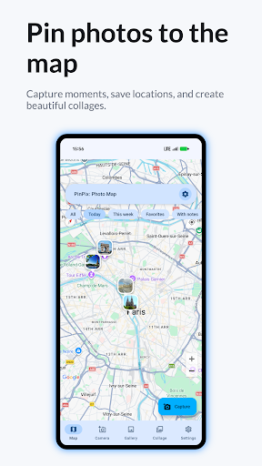
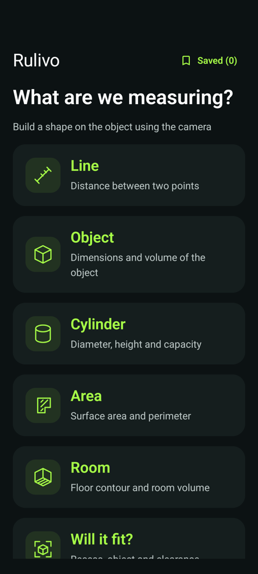

# Android Engineering Portfolio

**GeoStamp Camera, Rulivo AR Ruler and StatusSave.**

I am Ilya Prokofev. I build native Android applications that connect Kotlin interfaces with camera capture, AR geometry, location processing and Android media storage. This portfolio follows three published products into their actual source code: how data moves, how asynchronous work is coordinated, and where the current implementation has limits.

[Applications](#applications) · [Engineering work](#engineering-work) · [Source repositories](#source-repositories) · [Verification](docs/portfolio/VERIFICATION.md)

## Applications

| Application | User workflow | Implementation | Explore |
|---|---|---|---|
| **GeoStamp Camera / MapShots** | Capture or import photographs, assign places and create map collages | CameraX, Maps Compose, Room, Hilt, Canvas, MediaStore | [Source & README](https://github.com/ILYAPROKOFEV101/MapShots) · [Google Play](https://play.google.com/store/apps/details?id=com.ilya.safarshots) |
| **Rulivo AR Ruler & Tape Measure** | Measure lines, contours and rooms; calculate volumes, fit and materials | ARCore, OpenGL ES, Compose, StateFlow, AtomicFile | [Source & README](https://github.com/ILYAPROKOFEV101/Rulivo) · [Google Play](https://play.google.com/store/apps/details?id=com.ilya.rulivo) |
| **StatusSave** | Browse local status media, preview it and save copies to the gallery | SAF, MediaStore, Room, Hilt, Media3, WorkManager, Mutex | [Source & README](https://github.com/ILYAPROKOFEV101/StatusSave) · [Google Play](https://play.google.com/store/apps/details?id=com.statusvideo.statussaver) |

All three Google Play links are matched against the exact Gradle `applicationId`. Repository names and product branding differ in places; each README explains its own source snapshot and screenshot provenance.

## In the applications

| GeoStamp · photographs and places | Rulivo · measurement toolkit | StatusSave · local media |
|:---:|:---:|:---:|
|  |  |  |
| [Explore GeoStamp](https://github.com/ILYAPROKOFEV101/MapShots) | [Explore Rulivo](https://github.com/ILYAPROKOFEV101/Rulivo) | [Explore StatusSave](https://github.com/ILYAPROKOFEV101/StatusSave) |

The galleries use existing Android QA captures and published promotional screenshots. Renderer test output is identified separately in Rulivo's README. No replacement interface was generated. [Preview sources](docs/portfolio/SOURCES.md).

## Engineering work

### A camera-to-export pipeline with explicit degradation

**MapShots** stores a photo record before generating thumbnails, color information and map snapshots. Room emits later enrichment to the screens. The editor represents layer placement with normalized coordinates; its Canvas renderer exports from original image data while accounting for orientation and aspect ratio.

Mini-maps use memory and disk caches, timed HTTP requests, and a schematic fallback. The README follows unavailable GPS, failed map requests and expensive bitmap work through the relevant classes and documents the current EXIF and legacy-export boundaries.

→ [Capture, rendering and map fallbacks](https://github.com/ILYAPROKOFEV101/MapShots/blob/main/README.md#engineering-decisions)

### AR resource ownership and geometric computation

**Rulivo** gives a controller ownership of ARCore resources and serializes frame processing and scene mutations on the GL thread. Revision-tagged commands reject stale input, while detached frame snapshots update Compose. Surface selection checks tracking, plane boundaries and depth; scan preparation requires fresh observations after recovery.

Its geometry projects planar 3D contours into a local basis, validates polygons, triangulates concave fills, and derives box/cylinder/room wireframes. Camera-ray intersection supports height editing without needing a hit on the object's top. File-backed history uses atomic replacement and serialized IO. The documentation separates these implemented mechanisms from physical accuracy that still needs measurement.

→ [AR ownership, geometry and diagnostics](https://github.com/ILYAPROKOFEV101/Rulivo/blob/main/README.md#engineering-decisions)

### Android storage and coordinated background saves

**StatusSave** handles persisted SAF folder grants and legacy filesystem access, then publishes copied media through MediaStore. A singleton repository reserves source IDs under a mutex so manual saves and background scans do not copy the same item simultaneously. Auto-save batches at most three concurrent copies and isolates per-item failures.

The documentation identifies the coordination boundary: source identity is based on URI/path, locking is process-local, and a media write plus Room insertion is not one cross-system transaction. Media auto-save and optional SDK recovery use separate scheduling responsibilities.

→ [Storage access, save coordination and background work](https://github.com/ILYAPROKOFEV101/StatusSave/blob/main/README.md#engineering-decisions)

## Source repositories

This index contains the overview and preview assets. Each linked application is a separate source repository with its own Gradle wrapper and `app` module. Open or clone the individual project to build it; there is no combined Gradle build.

| Repository | Start reading |
|---|---|
| [MapShots](https://github.com/ILYAPROKOFEV101/MapShots) | `feature/`, `domain/`, `data/`, Hilt modules and the collage renderer |
| [Rulivo](https://github.com/ILYAPROKOFEV101/Rulivo) | `ar/`, `measure/`, toolkit state, localization and accuracy tools |
| [StatusSave](https://github.com/ILYAPROKOFEV101/StatusSave) | Storage repository, media use cases, workers and screen contracts |

Architecture descriptions follow the actual wiring: Hilt in MapShots and StatusSave, direct construction in Rulivo, and the state/persistence mechanisms each application uses. Per-project instructions specify JDK/SDK versions, local AAR requirements, provider configuration, permissions and build commands.

## Verification

The selected source and documentation were checked on **1 November 2026**. All three debug builds and JVM test tasks completed successfully: **165 JVM tests**, including generated template cases. Rulivo's localization checks also passed. [The verification record](docs/portfolio/VERIFICATION.md) gives per-project scope, exact source snapshots and validation limits.

Code links and images were checked against the files published in Git. Existing tests are distinguished from manual QA artifacts. Device-dependent AR accuracy, camera/GPS behavior, storage grants, background behavior and SDK integration still require device validation; no new device-test or CI result is implied.
