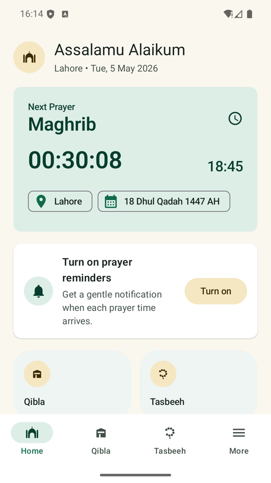
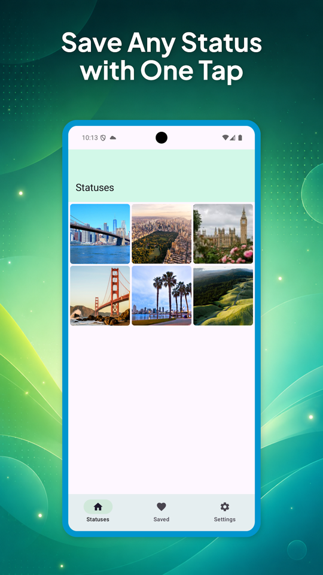
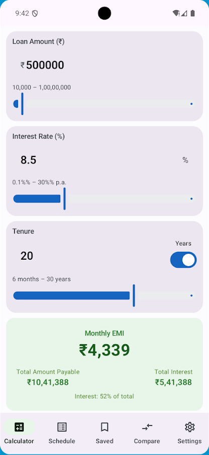

# Android Engineering Portfolio

**Seven native Android applications, with implementation details you can follow into the code.**

I am Ilya Prokofev. I build Android applications that combine Kotlin interfaces with the practical work behind them: camera and sensor lifecycles, geometry, local persistence, media storage, asynchronous operations and Android platform constraints. This collection documents the actual implementation of each application, including the boundaries of its current verification.

[Applications](#applications) · [Selected engineering work](#selected-engineering-work) · [Explore the collection](#explore-the-collection) · [Verification](docs/portfolio/VERIFICATION.md)

## Applications

| Application | User workflow | Technologies used | Explore |
|---|---|---|---|
| **Rulivo** | Measure lines, contours and rooms; calculate volumes, fit and materials | ARCore, OpenGL ES, Compose, StateFlow, AtomicFile | [README & source](https://github.com/ILYAPROKOFEV101/Rulivo/blob/main/README.md) · [Google Play](https://play.google.com/store/apps/details?id=com.ilya.rulivo) |
| **GeoStamp Camera / MapShots** | Capture or import photographs, assign places, design map collages | CameraX, Maps Compose, Room, Hilt, Canvas, MediaStore | [README & source](https://github.com/ILYAPROKOFEV101/MapShots/blob/main/README.md) · [Google Play](https://play.google.com/store/apps/details?id=com.ilya.safarshots) |
| **Pak Namaz** | Calculate prayer times offline, find Qibla and track Tasbeeh | Adhan2, rotation-vector sensor, AlarmManager, Room, DataStore, Hilt | [README & source](https://github.com/ILYAPROKOFEV101/PakNamazQiblaDua/blob/main/README.md) · [Google Play](https://play.google.com/store/apps/details?id=com.paknamaz.qibladua) |
| **StatusSave** | Browse local status media, preview it, save copies and enable auto-save | SAF, MediaStore, Room, Hilt, Media3, WorkManager, Mutex | [README & source](https://github.com/ILYAPROKOFEV101/StatusSave/blob/main/README.md) · [Google Play](https://play.google.com/store/apps/details?id=com.statusvideo.statussaver) |
| **EMI Loan Calculator** | Compare loans, inspect amortization and simulate prepayments | Compose Canvas, Room, Hilt, DataStore, PdfDocument, Play Billing | [README & source](https://github.com/ILYAPROKOFEV101/EMILoanCalculator/blob/main/README.md) · [Google Play](https://play.google.com/store/apps/details?id=com.loanplanner.emiloancalculator) |
| **GST Calculator India** | Calculate inclusive/exclusive tax, build invoices and search HSN codes | Room transactions/migration, Hilt, Flow, DataStore, HTTP, PdfDocument | [README & source](https://github.com/ILYAPROKOFEV101/GSTCalculatorIndia/blob/main/README.md) |
| **Pakistan Traffic Signs Test Urdu** | Study signs in three languages and practice with adaptive revision | Compose, Kotlin serialization, DataStore, manual DI, TextToSpeech | [README & source](https://github.com/ILYAPROKOFEV101/TrafficSignTestPakistanUrdu/blob/main/README.md) |

Play links are matched by the application's Gradle `applicationId`, rather than directory names. No published listing was verified for GST Calculator India or Pakistan Traffic Signs Test Urdu. The supplied [Run Tracker listing](https://play.google.com/store/apps/details?id=com.sport.runwalktracker) is a separate product: its source is absent from this workspace, so this portfolio makes no claim about its implementation.

## A look at the applications

| Rulivo · measurement toolkit | GeoStamp · places and photographs | Pak Namaz · prayer dashboard |
|:---:|:---:|:---:|
|  |  |  |
| [Explore Rulivo](https://github.com/ILYAPROKOFEV101/Rulivo/blob/main/README.md) | [Explore MapShots](https://github.com/ILYAPROKOFEV101/MapShots/blob/main/README.md) | [Explore Pak Namaz](https://github.com/ILYAPROKOFEV101/PakNamazQiblaDua/blob/main/README.md) |

| StatusSave · local media | EMI · loan planning | GST · tax toolkit | Traffic signs · learning |
|:---:|:---:|:---:|:---:|
|  |  |  |  |

The galleries distinguish existing Android QA captures, published promotional screenshots, deterministic renderer output and launcher artwork. Icons are used where no verified screen capture was available. Each application README links to its own visual sources; no replacement interface was generated. [Preview provenance](docs/portfolio/SOURCES.md).

## Selected engineering work

### AR resource ownership and geometric computation

**Rulivo** gives a controller ownership of ARCore resources and serializes frame processing and scene mutations on the GL thread. Revision-tagged commands reject stale input, while detached frame-state snapshots update Compose. Surface selection checks tracking, plane boundaries and depth, and scan preparation requires fresh observations after recovery.

Its geometry code projects planar 3D contours into a local basis, validates polygons, triangulates concave fills, and derives box/cylinder/room wireframes from measured and computed points. Camera-ray intersection supports height editing without needing a surface hit on an object's top. The README traces these mechanisms into the controller, geometry and renderer implementations; it does not claim an unmeasured accuracy tolerance.

→ [AR ownership, geometry and diagnostics](https://github.com/ILYAPROKOFEV101/Rulivo/blob/main/README.md#engineering-decisions)

### A camera-to-export pipeline with explicit degradation

**MapShots** stores a photo record before generating thumbnails, color information and map snapshots. Room emits later enrichment to the screens. The editor represents layer placement with normalized coordinates; its Canvas renderer exports from original image data while accounting for orientation and selected aspect ratio.

Mini-maps use memory and disk caches, timed HTTP requests, and a schematic fallback. This makes the handling of unavailable GPS, offline map requests and expensive bitmap work visible in the design rather than hidden behind a feature list.

→ [Capture, rendering and map fallbacks](https://github.com/ILYAPROKOFEV101/MapShots/blob/main/README.md#engineering-decisions)

### Android storage and concurrent work

**StatusSave** handles persisted SAF folder grants and legacy filesystem access, then publishes copied media through MediaStore. A singleton repository reserves source IDs under a mutex so manual saves and background scans do not copy the same item simultaneously. Auto-save batches at most three concurrent copies and isolates per-item failures.

The README also explains the limits: identity is based on source URI/path, coordination is process-local, and a media write plus Room insertion is not one cross-system transaction.

→ [Storage access, save coordination and background jobs](https://github.com/ILYAPROKOFEV101/StatusSave/blob/main/README.md#engineering-decisions)

### Sensor, time-zone and lifecycle integration

**Pak Namaz** calculates prayer times locally using city coordinates and time zones, supports configured adjustments, and derives Qibla bearing with device heading. A one-shot location path handles cancellation and fallback instead of keeping location collection active unnecessarily. Prayer alarms are scheduled for today and tomorrow and restored through a boot receiver.

Its documentation distinguishes those alarm responsibilities from optional SDK networking and records the current reminder horizon and real-device validation needs. Incomplete devotional datasets are not advertised as completed content.

→ [Offline calculations, compass and reminders](https://github.com/ILYAPROKOFEV101/PakNamazQiblaDua/blob/main/README.md#engineering-decisions)

### Domain algorithms with inspectable state transitions

**EMI Loan Calculator** simulates extra payments against the outstanding balance in month order, supports reducing either EMI or tenure, clamps final principal repayment, and bounds the simulation loop. Its PDF writer paginates long schedules with Android drawing APIs.

**GST Calculator India** shares forward/reverse tax result models, saves invoice headers and line items in one Room transaction, and migrates the existing schema explicitly. Currency conversion can use persisted/default rates when refresh fails; HSN search debounces input and publishes the latest query.

**Pakistan Traffic Signs Test Urdu** generates distractors from a broader catalogue even for a single-sign session. Per-sign mastery and review timestamps drive an explicit adaptive practice policy. A source audit distinguishes confirmed, practice-only and review-needed teaching material.

→ [Loan simulation](https://github.com/ILYAPROKOFEV101/EMILoanCalculator/blob/main/README.md#engineering-decisions) · [Tax, persistence and lookup](https://github.com/ILYAPROKOFEV101/GSTCalculatorIndia/blob/main/README.md#engineering-decisions) · [Adaptive learning](https://github.com/ILYAPROKOFEV101/TrafficSignTestPakistanUrdu/blob/main/README.md#engineering-decisions)

## Explore the collection

The index repository stores this overview and preview assets; each application lives in its own linked source repository. Each application is an independent Gradle project with its own wrapper and `app` module. Open the individual directory in Android Studio; this workspace is not a combined Gradle build.

```text
APP/
├── README.md                     Portfolio index
├── Rulivo/                       AR measurement and geometry
├── MapShots/                     Geotagged photographs and map collages
├── PakNamazQiblaDua/              Prayer times, Qibla and Tasbeeh
├── StatusSave/                   Local status-media management
├── EMILoanCalculator/             Loan calculation and prepayment modelling
├── GSTCalculatorIndia/            Tax calculation, bills and invoices
├── TrafficSignTestPakistanUrdu/   Multilingual sign learning
└── docs/portfolio/               Preview sources and verification record
```

The adjacent `Project_Handover`, `Project_Handover 2` and `handover-work-20261028` directories are transfer/verification copies of the same seven applications. They are not additional portfolio products and were left unchanged.

Architecture descriptions follow the actual dependency wiring: Hilt where used, direct construction/manual factories in Rulivo and Traffic Signs, and practical package boundaries rather than an assumed uniform architecture. Per-project instructions specify the real JDK/SDK versions, local AAR requirements, optional provider configuration, permissions and commands.

## Verification

The documentation was prepared against the source on **1 November 2026**. Code links, image files, package-to-Play matching and newly added materials were checked. [The verification record](docs/portfolio/VERIFICATION.md) reports the commands actually executed and their outcomes. Existing tests are distinguished from template checks and manual QA artifacts; no new CI pipeline or physical-device result is implied.

This portfolio preserves implementation tradeoffs alongside the working features. Real-device AR accuracy, compass behavior, Android storage grants, alarm delivery, billing and background SDK behavior have specific validation needs described in the application READMEs.
